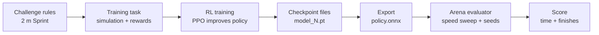
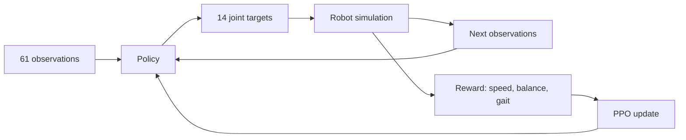

# Microduck 2 m Sprint: end-to-end training walkthrough

This guide follows the Hugging Face Jobs training run and checkpoint scores from this
checkout. It explains what the challenge asks the duck to do, how training produces a
policy, how to download and compare checkpoints, and how to publish one.

## Your run at a glance

| Item | Value |
|---|---|
| Challenge | 2 m Sprint (`sprint-2m`) |
| Training task | `Mjlab-Sprint2m-MicroDuck` |
| Hugging Face Job | [`6ad26b7b5ccb47ba0f7b499c`](https://huggingface.co/jobs/prithviraj-maurya/6ad26b7b5ccb47ba0f7b499c) |
| Checkpoint repo | [`prithviraj-maurya/mjlab-sprint2m-microduck-20261016-112248`](https://huggingface.co/prithviraj-maurya/mjlab-sprint2m-microduck-20261016-112248) |
| Training settings reported by the job | 4,096 environments, 3,000 iterations, seed 1, run name `first` |
| Downloaded run folder | `logs/rsl_rl/sprint_2m/2026-10-16_18-25-21_first` |
| Best of the tested checkpoints | `model_1500.pt`: **5.136 s, 5/5 finishes**, locally evaluated at 0.55 m/s |

The Hugging Face Job ID and checkpoint repo ID are different things. The job page shows
the job's status and logs; the checkpoint repo stores the files produced by training.

## Challenge, task, and policy

- **Challenge**: the Arena's rules and score for a 2 m Sprint. The duck starts on a flat,
  2 m lane and is asked to get to the finish quickly without falling.
- **Task**: the registered simulation and training setup named
  `Mjlab-Sprint2m-MicroDuck`. It defines the robot, observations, actions, rewards,
  randomization, and PPO training configuration. See
  [`challenge.toml`](src/microduck_challenges/sprint_2m/challenge.toml) and
  [`env.py`](src/microduck_challenges/sprint_2m/env.py).
- **Policy**: the learned function that maps sensor/command observations to joint
  targets. The Arena consumes the exported ONNX version, not the PyTorch training
  checkpoint directly.



## What the policy sees and controls

The Sprint policy receives **61 numbers** and outputs **14 joint position targets**.
Inputs include angular velocity, projected gravity, joint positions and velocities,
the previous action, and movement/head/body commands. The command is a desired forward
speed; the policy is not told its position on the course or its heading.

The task trains with PPO (Proximal Policy Optimization), a reinforcement-learning
algorithm. In each simulation step, the policy acts, the simulated duck moves, and
reward terms encourage behavior such as following the speed command, staying upright,
and stepping. Training repeats this experience and updates the policy. Many simulated
environments run in parallel to collect experience faster.



The training recipe in this challenge uses 4,096 environments and up to 3,000
iterations. It saves periodic PyTorch checkpoints such as `model_250.pt`,
`model_1500.pt`, and `model_2999.pt`. The final checkpoint is not guaranteed to be the
best: training can improve and regress, so checkpoints should be evaluated rather
than choosing the last one by default.

Export converts a selected checkpoint to `policy.onnx` and includes the observation
normalization needed at inference time. The exporter checks that the policy has the
expected 61-to-14 shape and that a smoke run produces finite, non-constant outputs.
The Arena runs that ONNX policy, not the training loop.

## The Arena score

For the Sprint, the Arena sweeps forward commands from **0.20 to 1.20 m/s**. It first
tests each speed, then re-tests the three fastest candidates over five seeds. Finishing
all five runs matters: a fall or timeout is penalized heavily. The useful priority is:

1. Finish **5/5** seeds.
2. Among 5/5 results, minimize the reported time.

The local `arena score` evaluator is a way to compare policies before publishing. Its
simulation result can differ from the official Arena result, so the official entry is
the final measure.

## Your checkpoint results

These are the local Arena-evaluator results you reported:

| Checkpoint | Score | Command speed | Result |
|---:|---:|---:|---|
| 0 | 50.000 s | 0.60 m/s | 0/5 finished |
| 250 | 11.036 s | 0.25 m/s | 5/5 finished |
| 1500 | **5.136 s** | 0.55 m/s | **5/5 finished — best tested** |
| 2999 | 5.196 s | 0.55 m/s | 5/5 finished |

Checkpoint 1500 is 0.060 seconds faster than checkpoint 2999 in this local evaluation.
The result you pasted for checkpoint 1500 listed seed times of 5.16–5.22 seconds.
It is a valid 5/5 finish, but it does not beat the local reference score cited in the
Sprint guide (4.892 seconds). This comparison is indicative only; the official Arena
may score differently.

## End-to-end commands

Run these from the repository root. You have already authenticated with Hugging Face;
`whoami` is a safe way to check the active account:

```bash
uv run hf auth whoami
```

### 1. Download the trained run

```bash
uv run hf download \
  prithviraj-maurya/mjlab-sprint2m-microduck-20261016-112248 \
  --local-dir logs/rsl_rl

find logs/rsl_rl/sprint_2m/2026-10-16_18-25-21_first \
  -type f -name 'model_*.pt'
```

The job also auto-exported an ONNX file into the checkpoint repo at
`exported/policy.onnx`. To download and score that file directly:

```bash
uv run hf download \
  prithviraj-maurya/mjlab-sprint2m-microduck-20261016-112248 \
  exported/policy.onnx --local-dir logs/downloaded-policy

uv run --group workshop arena score \
  logs/downloaded-policy/exported/policy.onnx --event sprint-2m
```

That ONNX is the job's auto-export, not necessarily the best checkpoint. To score a
particular checkpoint, export it locally and run the Arena evaluator:

```bash
run=logs/rsl_rl/sprint_2m/2026-10-16_18-25-21_first

uv run publish --run "$run" --checkpoint 1500 \
  --repo local/microduck-eval --dry-run --allow-dirty

uv run --group workshop arena score \
  publish-eval/policy.onnx --event sprint-2m
```

`--dry-run` prepares the ONNX and supporting files locally; it does not publish to
Hugging Face or enter the Arena.

### 2. Publish the best tested checkpoint

The publish command checks out and exports the selected checkpoint, then uploads the
policy to the Hub repo. The target repo already contains `policy.onnx`, so `--force`
is needed to replace it with checkpoint 1500.

**For a public Hub policy and an Arena entry:**

```bash
uv run publish \
  --run logs/rsl_rl/sprint_2m/2026-10-16_18-25-21_first \
  --checkpoint 1500 \
  --repo prithviraj-maurya/microduck-sprint-2m-policy \
  --no-private --enter --force
```

`--no-private` makes the model repo public. The Arena only reads public policy repos;
`--enter` submits the policy to the Sprint event. `--force` replaces the existing
`policy.onnx` rather than adding a second ONNX policy. The command should print the
official result and a link to the entry when it completes.

**For a private Hub upload only**, omit `--no-private` and `--enter`:

```bash
uv run publish \
  --run logs/rsl_rl/sprint_2m/2026-10-16_18-25-21_first \
  --checkpoint 1500 \
  --repo prithviraj-maurya/microduck-sprint-2m-policy \
  --force
```

A private upload cannot be entered in the Arena. Publishing replaces the repo's
existing policy, so use the intended repo and visibility flags.

## Terms in one minute

| Term | Meaning here |
|---|---|
| Observation | Numbers describing the robot's state and the requested command |
| Action | The 14 joint targets output by the policy |
| Reward | Training feedback that encourages desired simulated behavior |
| Iteration | A PPO training update after collecting simulation experience |
| Checkpoint | Saved PyTorch weights at one point in training |
| ONNX | Portable exported policy format accepted by the Arena |
| Seed | A setting that controls simulation randomness; different seeds test robustness |
| 5/5 | The policy finished all five scored Arena trials |
| Checkpoint repo | Hugging Face model repo where the job stores training artifacts |
| Job ID | Identifier for the cloud job itself; it is not the checkpoint repo name |

For the official challenge workflow and more details about judging checkpoints, see
[`src/microduck_challenges/sprint_2m/AGENTS.md`](src/microduck_challenges/sprint_2m/AGENTS.md)
and the [repository README](README.md).
