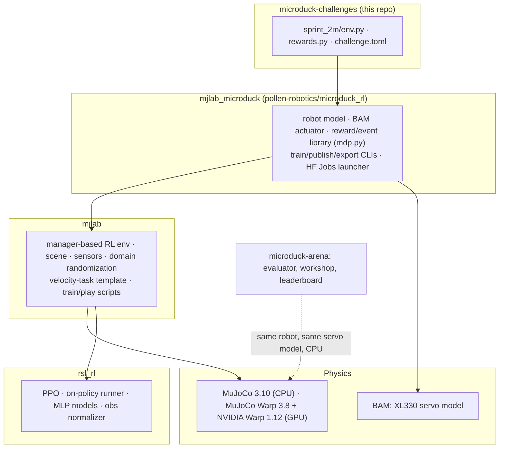

# 3. Code tour

Five codebases cooperate to turn your `env.py` into a race time. This guide covers what each one
is, which files matter, and what is already built.

## The stack, bottom to top



| Library | Version here | What it does for you |
|---|---|---|
| **MuJoCo** | 3.10.0 | The physics engine: rigid bodies, joints, contacts, friction. Reads the robot's MJCF (`.xml`) files. Also used on CPU by the Arena and the examples |
| **MuJoCo Warp** + **NVIDIA Warp** | 3.8.1 / 1.12.0 | MuJoCo rewritten as GPU kernels, so 4096 ducks step in parallel. Warp is the Python-to-GPU compiler underneath |
| **mjlab** | 1.3.0 | The RL framework ([mujocolab/mjlab](https://github.com/mujocolab/mjlab)). It turns "a robot + a list of rewards, observations, events" into a batched environment, and ships the `train`/`play` scripts and a velocity-tracking template |
| **rsl_rl** | 5.0.1 | The RL algorithm library (from ETH Zurich's Robotic Systems Lab): PPO, the rollout buffer, the training loop, the neural networks |
| **PyTorch** | 2.9.1 | Tensors and autograd. Every reward and observation is a batched torch operation over all 4096 robots |
| **BAM** | pinned commit `62bd8ce` | Rhoban's fitted servo model ([Rhoban/bam](https://github.com/Rhoban/bam)); `bam.mjlab.BamActuator` plugs it into mjlab |
| **mjlab_microduck** | `challenge-recipe-publishing` branch | Everything Microduck-specific (below) |
| **microduck-arena** | 0.5.0 | The evaluator, workshop UI and leaderboard engine, in the `workshop` dependency group |
| **onnx / onnxruntime** | 1.23 / 1.24 | Export format and the runtime that executes it in the Arena and on the robot |
| **tyro** | 1.0 | Turns config dataclasses into command-line flags, which is why `--agent.max-iterations` works |
| **huggingface_hub** | | Uploads, downloads and HF Jobs |

`pyproject.toml` pins all of this. Its comments are worth reading: each override there fixes a
real breakage, from protobuf and onnx wheels to a broken `zmq` stub and the torch build for ARM.

## This repo: microduck-challenges

```text
src/microduck_challenges/
  __init__.py              imports every challenge's tasks.py, which registers its mjlab task
  sprint_2m/
    challenge.toml         the contract: Arena event, task id, kind, recipe, the three knobs
    env.py                 the whole training environment (yours to change)
    rewards.py             your custom reward terms (hypothesis 4: lane_progress, lane_drift, …)
    tasks.py               registers "Mjlab-Sprint2m-MicroDuck" with mjlab
    AGENTS.md              the challenge's rules and what is known to work
  hill_climb_1m5/ roller_sprint_2m/ got_a_talent/    the other Arena challenges, same shape
tests/
  test_challenges.py       38 tests: every challenge builds, obs is 61-D, knobs in range, …
  test_arena_actuator_parity.py   8 tests: the Arena's numpy servo == training's BAM servo
  test_got_a_talent.py     18 tests
  test_package.py          2 tests
hypothesis/                your experiment write-ups
docs/                      your guides (this folder included)
```

How the pieces connect:

1. `pyproject.toml` declares an entry point in the group `mjlab.tasks`. When mjlab starts, it
   imports every package in that group, so it imports `microduck_challenges`.
2. That runs each challenge's `tasks.py`, which calls `register_mjlab_task(task_id=...,
   env_cfg=make_env_cfg(), rl_cfg=RL_CFG, ...)`.
3. `uv run train Mjlab-Sprint2m-MicroDuck` then looks the task up by name.

`env.py` reads the three knobs through `challenge.params(__file__)`, so the workshop UI and a
shell user edit the same `challenge.toml` and train the same thing.

`sprint_2m/env.py` is a full copy of `microduck_rl`'s velocity task, made the Sprint's own:

- flat ground;
- the command range set to the Arena's 0.20–1.20 m/s, straight ahead;
- `heading_hold` added, since the Arena never tells the duck its heading;
- your hypothesis 4 changes.

It is about 900 lines. Most of it is the domain-randomization and observation-noise setup
that makes policies transfer to the real robot. Guide 4 walks through it.

## mjlab_microduck (the `microduck_rl` repo)

Installed in `.venv/lib/python3.12/site-packages/mjlab_microduck/`. A checkout of its `develop`
branch sits next to this repo in `../microduck_rl`. That checkout is not the installed version,
so read the installed copy when the details matter.

| Path | What is in it |
|---|---|
| `robot/microduck/*.xml` | The MJCF robot models and scenes (guide 1), plus the STL meshes in `assets/` |
| `robot/microduck_constants.py` | `HOME_FRAME` (the STAND pose), the BAM actuator settings, and one `EntityCfg` per robot model |
| `actuator/friction_dr_bam.py` | BAM actuator subclasses: per-robot friction randomization, and an encoder that reads through backlash |
| `tasks/mdp.py` | **7,400 lines**: every Microduck reward, event, observation, command and curriculum function, including `head_pose_tracking`, `heading_hold_reward`, `standing_envs_curriculum` and `reward_weight` |
| `tasks/microduck_*_env_cfg.py` | One file per task family: velocity (walking), velstand, standup, sitstand, ground pick, ball kick, roulade, rollers, swizzle, spin, … |
| `tasks/__init__.py` | Registers about 18 tasks, plus a `-Backlash-` twin for most |
| `tasks/symmetry.py` | Left-right mirroring of the 61 observations and 14 actions, for the mirror loss |
| `tasks/backlash.py` | Wraps any task into its backlash twin |
| `train_cli.py`, `train_hook.py`, `hf_jobs.py`, `hf_uploader.py` | `uv run train`. The hook catches `--hf-jobs`: it tars your checkout, uploads it and submits the job; a watcher in the job uploads checkpoints as they appear |
| `export.py` | Checkpoint → ONNX, with the observation normalizer baked in (guide 5) |
| `publish/` | `uv run publish`: export, check, write the manifest, upload, and optionally enter the Arena |
| `challenge.py` | Reads `challenge.toml` |
| `infer.py` | Keyboard-driven CPU rehearsal of the robot runtime, with several policies hot-swapped |
| `provenance.py` | Records which commit trained a run (`provenance.json`); `publish` refuses a dirty one |

Its own [AGENTS.md](../../../microduck_rl/AGENTS.md) holds the reward-design lessons learned on
this robot. It is the best single read after these guides.

## mjlab

Installed in `.venv/lib/python3.12/site-packages/mjlab/`.

| Path | What is in it |
|---|---|
| `envs/manager_based_rl_env.py` | `ManagerBasedRlEnv`: the `step()` loop (guide 4 walks through it) |
| `managers/` | One manager per concern: observation, action, reward, termination, event, command, curriculum, metrics. Each reads a dict of term configs from your `env.py` |
| `envs/mdp/` | Generic terms: joint-position actions, `action_rate_l2`, `joint_pos_limits`, `bad_orientation`, the `dr.*` randomizers |
| `tasks/velocity/` | The velocity template your env starts from (`make_velocity_env_cfg`), and its rewards: `track_linear_velocity`, `feet_air_time`, `feet_clearance`, `feet_slip`, … |
| `entity/`, `scene/`, `sim/` | The robot as a batched object, the scene, and the Warp simulation wrapper |
| `actuator/` | Actuator base classes; BAM plugs in here |
| `sensor/` | Contact sensors, used for feet touching the ground and self-collisions |
| `rl/` | The glue to rsl_rl: runner configs (`RslRlOnPolicyRunnerCfg`), the vec-env wrapper, ONNX export utilities |
| `scripts/train.py`, `play.py` | The `train` and `play` commands |

## rsl_rl

Installed in `.venv/lib/python3.12/site-packages/rsl_rl/`.

| Path | What is in it |
|---|---|
| `algorithms/ppo.py` | PPO: `act`, `compute_returns` (GAE), `update` (clipped surrogate, value loss, entropy, adaptive learning rate, mirror loss) |
| `runners/on_policy_runner.py` | `learn()`: collect 24 steps → compute returns → update → log → save, repeated |
| `models/`, `modules/` | The MLP actor and critic, the Gaussian action distribution, the running observation normalizer |
| `storage/` | The rollout buffer |

## The Arena (microduck-arena)

Installed in `.venv/lib/python3.12/site-packages/arena/`.

| Path | What is in it |
|---|---|
| `events/sprint-2m.toml` | The Sprint's rules: 2 m lane, 0.8 m wide, walls 0.15 m high, seeds 1–5, sweep 0.20–1.20 m/s step 0.05, 3 finalists, fall at gravity z > −0.5 held 0.3 s, 50 s limit |
| `constants.py` | The interface: joint order, STAND pose, 61 in / 14 out, 50 Hz. Kept equal to training's |
| `actuator.py` | A numpy copy of the BAM XL330 model, so the Arena needs no torch or GPU |
| `runner.py` | One race: build the 61 observations, run the ONNX, drive the servos, step MuJoCo. `examples/policy_loop.py` is a shortened copy |
| `evaluate.py` | The sweep and finalists → your score |
| `workshop/` | The `workshop` browser UI |

## What is already built (and what is not)

**Built:**

- About 18 trainable tasks, from walking to roulades and roller skating.
- Backlash variants of most of them.
- A servo model fitted to the real servo.
- Domain randomization of mass, centre of mass, friction, rotor inertia, battery, delays,
  IMU mounting and encoder offsets.
- A mirror-symmetry loss.
- Training on rented GPUs (`--hf-jobs`).
- ONNX export with the normalizer included.
- Publishing to the Hub with a manifest the robot can install.
- A local evaluator identical to the official one.

**Not built, or off by default:**

- Rough terrain in the Sprint (flat only; the template supports it).
- Recurrent (memory) policies: the config has `rnn_type`, but every Microduck task uses a plain
  MLP.
- Action filtering (policies are trained unfiltered; see guide 5).
- An Arena seed replay inside `infer`.

## Commands, all in one place

| Command | From | Does |
|---|---|---|
| `uv run train <task> …` | mjlab + `train_hook` | Train locally (CUDA), or `--hf-jobs` to rent a GPU |
| `uv run play <task> --checkpoint-file …` | mjlab | Watch a checkpoint in a viewer (the browser viewer currently crashes on the Sprint; guide 2) |
| `uv run list-envs` | mjlab | List every registered task |
| `uv run publish --run … --checkpoint N --repo … [--dry-run] [--no-private --enter]` | mjlab_microduck | Export, check, upload, enter |
| `uv run infer --walking policy.onnx` | mjlab_microduck | Keyboard rehearsal (viewer needs `mjpython` on macOS) |
| `uv run --group workshop arena score <onnx> --event sprint-2m` | arena | The official score, locally |
| `uv run --group workshop workshop sprint-2m` | arena | The workshop UI |
| `uv run --group workshop pytest` | | The 66 tests |

Next: [4. How RL is implemented](04_RL_PIPELINE.md).
