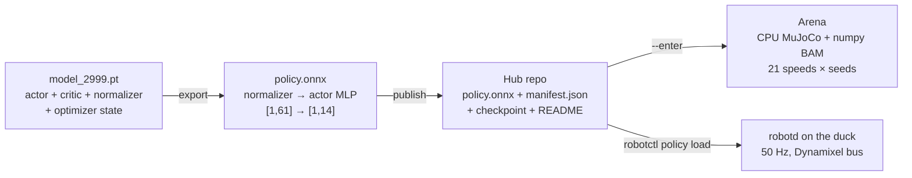

# 5. From policy to motors

Training produced `model_2999.pt`. This guide follows it through four stages:

1. **Export:** the checkpoint becomes an ONNX file.
2. **Publish:** the ONNX file goes to the Hub.
3. **Arena:** the evaluator races it.
4. **Real robot:** the robot's runtime turns its 14 outputs into servo commands.

At every stage, the thing to protect is the same contract: **61 numbers in, in a fixed order and
meaning; 14 joint offsets from STAND out, at 50 Hz.**



## Stage 1: checkpoint → ONNX

A checkpoint (`model_N.pt`) holds:

- the actor;
- the critic;
- the observation normalizer's running mean and standard deviation;
- the optimizer state;
- the iteration count.

Only two of these are needed to drive a robot: the normalizer and the actor's mean output.

`mjlab_microduck/export.py` builds the task's environment and loads the checkpoint into a
runner. It then calls `export_policy_to_onnx`, which writes one graph:

```text
action = actor_MLP( (obs − running_mean) / running_std )      # [1, 61] → [1, 14]
```

The exploration noise is dropped; the robot runs the mean action. Metadata goes into the file too:
the task id, the checkpoint and its sha256, and the run path.

**Why "never convert by hand" is a rule.** The `play` command applies the normalizer itself, so a
hand-converted network without it looks perfect in simulation. On the robot it then sees raw
inputs, values ten times off the scale it learned on, and fails. The export path is the one
place this is guaranteed.

`publish --dry-run` runs the same export locally. That is how every checkpoint you scored was
made (section 7 of the [command reference](../SPRINT_2M_COMMAND_REFERENCE.md)).

## Stage 2: publish

`uv run publish --run <run dir> --checkpoint N --repo <you>/microduck-<name> [--no-private --enter]`
(`mjlab_microduck/publish/`) does five things:

1. **Exports** through the path above. It never uses an ONNX it didn't make, unless you pass
   `--onnx`.
2. **Checks** the graph is `[1,61] → [1,14]`, runs it on plausible inputs, and refuses NaNs or
   a constant output.
3. **Writes `manifest.json`** (schema 2), which tells the robot's runtime what this policy is:
   - its *kind* (`perpetual` for a gait, `episodic` for a trick);
   - what each command slot means;
   - the training provenance: task, commit, dirty flag, checkpoint.
4. **Refuses** a run trained from uncommitted code. That is why each of your hypotheses is one
   commit.
5. **Uploads** to a new Hub repo, private unless `--no-private`. With `--enter`, it also
   submits the policy to the Arena.

## Stage 3: the Arena

The Arena (`arena/runner.py`) runs the ONNX in CPU MuJoCo with a numpy copy of the BAM servo
model. It does not use training's GPU code; it re-implements the same physics so that a hosted
Space can run it without torch.

Each control step:

```text
obs[0:3]   = gyro (imu_ang_vel sensor)
obs[3:6]   = trunk_rotationᵀ · (0, 0, −1)          # projected gravity
obs[6:20]  = joint angles − STAND
obs[20:34] = joint velocities from one step ago    # training's fixed one-step lag
obs[34:48] = last action
obs[48:61] = command (vx from the sweep, the rest 0)
action     = onnx(obs)
target     = STAND + 1.0 × action
4 × { drive the BAM servos toward target; mj_step(5 ms) }
drive the servos once more; mj_forward
```

That extra fifth servo drive (and one at reset, on 0 rad targets) looks odd. It is there on
purpose: mjlab does the same during training whenever any of the 4096 environments resets, which
is nearly every step. The Arena copies even that, because a policy learns every quirk of the
simulator it trained in. `tests/test_arena_actuator_parity.py` checks that the numpy servo matches
training's BAM servo.

Scoring (`arena/evaluate.py` and `events/sprint-2m.toml`):

1. Start from STAND with small joint noise (±0.01 rad) and a random heading (±2°).
2. Let the robot settle for 0.5 s, then start the clock.
3. Sweep vx from 0.20 to 1.20 m/s in steps of 0.05, on seed 1.
4. Rerun the 3 fastest speeds on seeds 1–5.
5. Score = the best mean time. A fall counts as 50 s.

Seeds change the servo delays and the start noise. Everything else runs at nominal values: the
battery at 7.35 V, the centre of the friction range, no shoves.

## Stage 4: the real robot

The robot's software is the [pollen-robotics/microduck](https://github.com/pollen-robotics/microduck)
repo, written in Rust. **The facts below come from its README and two design docs
(`docs/design/architecture.md`, `docs/design/robotd-design.md`), read on 2026-11-18. I did not
check them against its code**, so treat exact values as "as designed".

**The hardware path.**

- A Rockchip RK3566 board runs a set of small services ("daemons"). The control one is
  `robotd`.
- `robotd` owns one serial bus, `/dev/ttyS2` at 1 Mbps, speaking Dynamixel protocol 2.0.
- On that bus sit the 15 servos and an IMU board, which has its own Dynamixel ID, 200.
- Servo IDs:

| Group | IDs |
|---|---|
| Right leg | 10–14 |
| Left leg | 20–24 |
| Neck, head, mouth | 30–34 |

**One tick of `robotd`, 50 times a second (every 20 ms):**

```text
read     one sync_read: the IMU board + 15 servos (pwm, current, velocity, position)
decide   build the 61 observations → run the ONNX → targets = home pose + action_scale × action
         → clamp to the servo range (non-finite targets refused)
write    one sync_write of 15 goal positions (the mouth's slot comes from elsewhere)
publish  state for any subscribed client
```

How it lines up with what you trained:

- **Observation.** Gyro and gravity come from the IMU board's on-chip orientation estimate,
  projected into the trunk frame. Joint position and velocity come from the servo registers
  read in the same sync_read. The layout is
  `[gyro 3 | gravity 3 | joint_pos 14 | joint_vel 14 | last_action 14 | command 13]`, the same
  as training's. The mouth is left out of the 14.
- **Action.** `home pose + action_scale × action`, where the home pose must equal training's
  `HOME_FRAME`. The servo firmware then runs its own position loop, the one BAM models:
  - P gain only (I and D are 0);
  - `return_delay_time` set to 0, to save bus time;
  - current limit 1000 mA.
- **Policy slots.** walk, stand, roulade, kick, ground pick and sit/rise. Only one move runs at
  a time. Priority: roulade > kick > ground pick > sit/rise > stand > walk. Every policy is
  validated at load (61 in, 14 out) and warmed up before the loop starts.
- **Safety.** A safety layer is the only code allowed to write to the bus.
  - **Deadman:** if commands stop arriving, the velocity command goes to zero.
  - **Limp-fall:** at about 26° of tilt, projected 0.3 s ahead, the robot goes limp, waits
    for the gyro to settle, then stands up.
  - **Pickup:** lifting the robot pauses the policy.
  - **Battery:** at 6.6 V the robot sits down and powers off.

Where a published Sprint policy would go: `uv run publish` writes a manifest that
`robotctl policy load walk <repo>` (for a gait) or `robotctl policy add <name> <repo>` can
install. Your Sprint policy ignores its speed command and always sprints (guide 2). As a `walk`
gait on a real robot it would run at full speed whatever you asked, so it is a race policy, not a
walking policy.

### Points where the sources disagree

These don't affect the Arena, but they matter on a real robot. Check them before trusting a
transfer:

- **Action filtering.** The runtime design doc describes a first-order low-pass filter on head
  and leg targets, "alphas are the trained values". `microduck_rl`'s AGENTS.md says the opposite:
  "Policies are UNFILTERED (no action low-pass in training). Don't add EMA filtering without a
  matched runtime flag." Your Sprint env has no filter. Whatever the robot does, it must match
  training.
- **Current limit.** The runtime sets the servos to 1000 mA. BAM's XL330 model, which training
  and the Arena use, limits at 1.75 A. If the real limit is lower, the real servos are weaker at
  large errors than the simulated ones.
- **Compute board.** As guide 1 says, the simulation's CAD carries a Raspberry Pi Zero 2 W board.
  The project README says RK3566. This only matters as mass.
- **IMU mounting.** The real board has a systematic pitch offset of about 5°, according to a
  comment in `env.py`. It is corrected in the runtime, not in training: training's ±6° IMU
  randomization averages to zero and cannot learn a fixed bias.

## The sim-to-real checklist, in one place

Everything below exists in training so the 14 numbers mean the same thing on the real robot:

| Real-world effect | How training covers it |
|---|---|
| Soft, slow, voltage-dependent servos | BAM XL330 model, battery 6.5–8.2 V, voltage sag under load |
| Bus and processing latency | 15–30 ms command delay; IMU readings 0–20 ms late; joint velocity one step old |
| Gear friction differs per servo | Friction ±10%, rotor inertia ±10% |
| Manufacturing differences | Mass and inertia ±5%, centre of mass ±3 mm and more |
| Imperfect calibration | Encoder offsets ±0.86° per joint, IMU mounting error up to 6° |
| Floor differences | Foot friction 0.7–1.3 |
| Bumps and nudges | Shoves of ±0.3 m/s every 3–6 s |
| Gear play | `-Backlash-` task variants (not used by the Sprint) |
| Sensor noise | Uniform noise on every actor observation |

What the Sprint does **not** cover is reaching the end of the lane: there are no walls in training.
Your `lane_drift` term exists for that reason.

Back to the [index](README.md).
