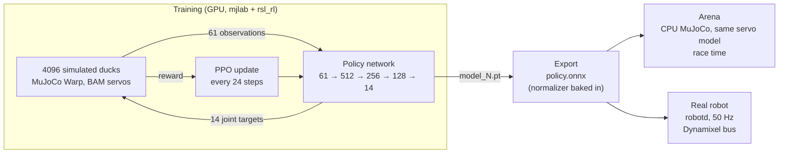

# Learning the Microduck, end to end

Five guides, from the robot's body to the code that teaches it to walk and back out to its
motors. Each one stands alone; read them in order the first time.

| # | Guide | Answers |
|---|---|---|
| 1 | [The robot](01_ROBOT.md) | What is it made of? What are the 14 joints? How does a servo turn a target angle into torque? What does it sense? |
| 2 | [Try it in simulation](02_TRY_IN_SIMULATION.md) | How do I poke a joint, watch a policy, and judge one, on my own Mac, for free? |
| 3 | [Code tour](03_CODE_TOUR.md) | Which repos and libraries are involved, what does each file do, what is already implemented? |
| 4 | [How RL is implemented](04_RL_PIPELINE.md) | What happens in one training step and one PPO update? Where do rewards, observations and curricula live? What do the log numbers mean? |
| 5 | [From policy to motors](05_POLICY_TO_MOTORS.md) | How does a checkpoint become an ONNX file, an Arena score, and servo commands on the real robot? |

Runnable examples for guide 2 are in [examples/](examples/).

## The whole picture in one diagram

The same 61 numbers go in and the same 14 numbers come out in all three places: training, the
Arena and the robot. Almost everything in these guides is about keeping those three worlds
alike.

## Where the facts come from

Everything here was read from the code installed in this checkout on 2026-11-18, not from
memory: `mjlab` 1.3.0, `rsl_rl` 5.0.1, `mujoco` 3.10.0, `mujoco_warp` 3.8.1, the `mjlab_microduck`
package pinned in `pyproject.toml`, the Arena 0.5.0 wheel, and BAM at the pinned commit. Numbers
marked "measured" came from running the examples in this folder. The on-robot runtime lives in a
different repo ([pollen-robotics/microduck](https://github.com/pollen-robotics/microduck)); guide 5
says which facts came from its design docs and were not checked against its code.

If a dependency is upgraded, the file paths and line references may move; the ideas will not.
