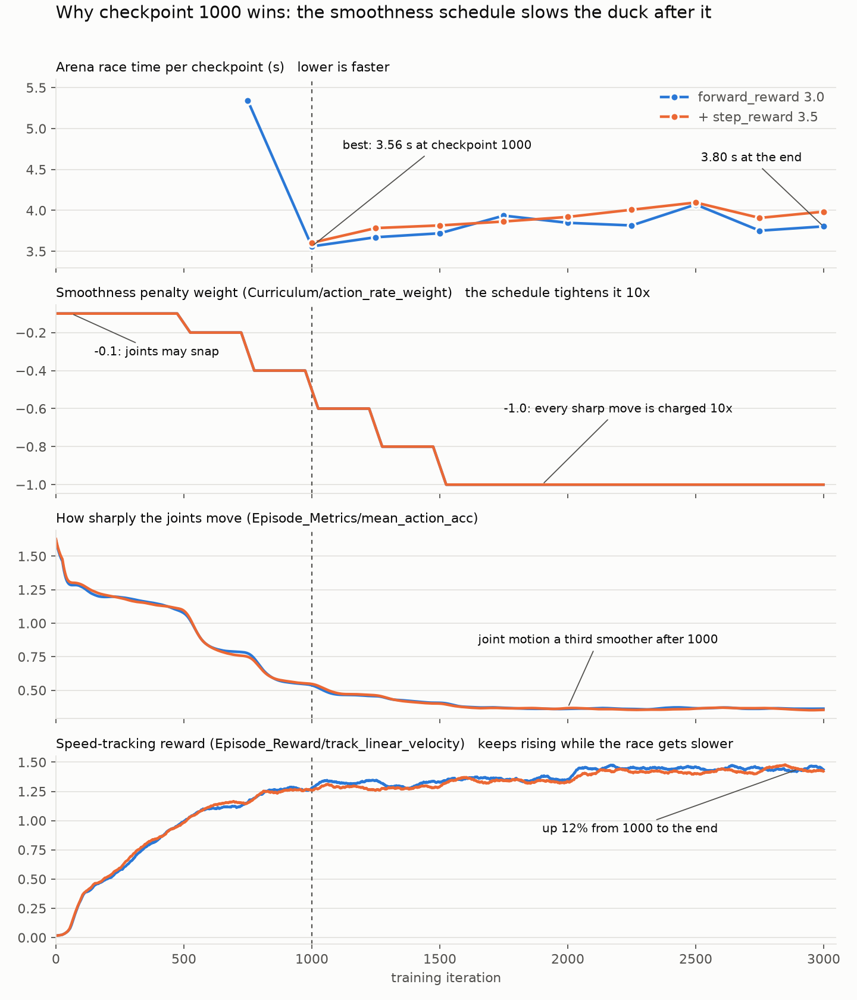
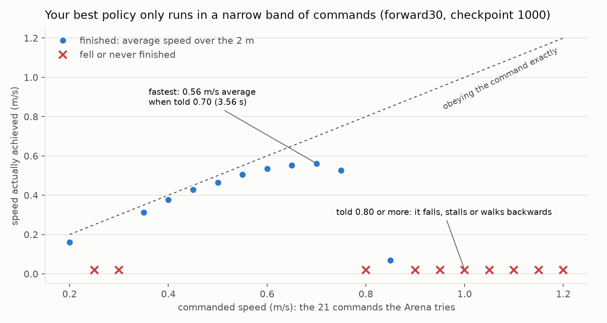

# Hypothesis 4: pay for speed itself, and stop taxing it

Status: **run finished 2026-11-16, hypothesis supported.** Best checkpoint 2999: 1.232 s, 5/5
(local); entered on the Arena 2026-11-17 at 1.229 s, 5/5. See the run record at the end.

## What the first three hypotheses told us

| Run | Change | Best local score | Best checkpoint |
|---|---|---:|---:|
| control | defaults (forward 2.0) | 5.048 s | — |
| hyp 1 | `forward_reward` 2.5 (two seeds) | 3.884 s, 3.864 s | 1000 |
| hyp 2 | `forward_reward` 3.0 | 3.560 s | 1000 |
| hyp 3 | `step_reward` 3.5 | 3.604 s (rejected) | 1000 |

Two patterns repeat in every run, and both have a cause we can see in the data.

### Pattern 1: checkpoint 1000 always wins, then the duck gets slower



Read the four panels top to bottom; they share the same x-axis (training iteration).

1. **Arena race time** is the only panel that is the score. Best at 1000, worse after.
2. **`Curriculum/action_rate_weight`** is a schedule built into `env.py`, not something the
   policy learns. `action_rate_l2` charges the policy for changing its joint targets quickly.
   The schedule multiplies that charge by 10 between iteration 500 and 1500.
3. **`Episode_Metrics/mean_action_acc`** shows the policy obeying: its joint motion becomes a
   third smoother after 1000 (0.54 → 0.36). A fast gait needs sharp leg movements, so a
   smoother duck is a slower duck.
4. **`Episode_Reward/track_linear_velocity`** keeps rising the whole time. This is the trap.
   Part of the rise comes from another schedule, `Curriculum/standing_envs`, which grows the
   share of robots told to stand still from 2% to 25%. Standing still tracks a zero command
   perfectly, so the average reward goes up while the racing duck slows down.

The lesson for reading curves: **a reward curve answers "is the policy collecting more of what
I pay for", never "is it faster".** When a curve and the Arena disagree, look for a
`Curriculum/*` curve that moved at the same iteration.

### Pattern 2: the duck never runs faster than about 0.56 m/s



This is the Arena's own sweep of the best policy (`arena score` prints it; it takes 7 s).
Each dot is one commanded speed. On the dashed line the duck would obey exactly.

- It follows commands up to about 0.6 m/s, tops out at 0.56 m/s, and at 0.80 m/s or more it
  falls, stalls or walks backwards. More than half of the commands it trains on are ones it
  cannot do.
- The reason is the shape of the tracking reward, `exp(-error² / 0.1)`. It is a bell curve
  around the command. A duck walking 0.5 m/s under a 1.1 m/s command has an error of 0.6 and
  earns `exp(-3.6)` = 3% of the reward. Walking 0.55 instead earns 5%. Nothing there pulls it
  faster. `Metrics/twist/error_vel_xy` says the same thing: it sat near 1.0 in every run.
- Raising `forward_reward` (hyp 1, hyp 2) made the bell taller, which helped where the duck
  was already close to its command. It cannot fix the flat part. That is why 2.0 → 2.5 → 3.0
  gave 5.05 → 3.88 → 3.56 s with shrinking returns, and why others with the knob at 5.0 reach
  about 1.9 to 2.1 s and stop: the bell also charges for going faster than the top command.

## The claim

**Hypothesis:** the speed limit is the reward's shape and the smoothness schedule, not the
robot. Paying linearly for speed down the lane, charging nothing for exceeding the command,
and capping the smoothness charge at −0.3 will bring the best 5/5 checkpoint under **1.5 s**,
and the best checkpoint will be late in the run instead of at 1000.

## Where the recipe comes from

It is not ours. [heyskylark's fork](https://github.com/heyskylark/microduck-challenges)
publishes a log of about 50 PPO runs (`sprint_2m/EXPERIMENTS.md`) that went from 4.80 s to
1.233 s, one change per run, each judged on the Arena evaluator, most on two seeds. Their A1
run is the same idea as our hyp 2 (`forward_reward` 4.0: 2.80 s, best at checkpoint 700, slower
after 1000). Re-measuring
each of their steps would cost us about $2 a step for numbers that are already public, so
this run takes their final recipe ("LX") whole and we spend what is left of the budget on
questions nobody has answered.

`env.py` here is identical to their LX commit `789ffc5` apart from comments (checked by diff).
`rewards.py` is written fresh against the same formulas and checked against hand-computed
values. Credit them in the commit message and the model card if this is published.

## What changes, and the curve that shows each one working

| Change | Their measured gain | Curve to watch in our run |
|---|---|---|
| `lane_progress`, weight 10: pays `speed / 2 m/s`, whatever the command | −1.9 s, then −0.23 s | **`Metrics/lane_speed_mean`** (new): plain m/s down the lane. The one training curve that is nearly the score |
| `action_rate_l2` schedule capped at −0.3 (was −1.0) | −0.73 s | `Curriculum/action_rate_weight` flat from 750; `mean_action_acc` stays high |
| Forward tracking one-sided: faster than the command is free | −0.28 s | `Episode_Reward/track_linear_velocity` rises toward its weight (2.0) |
| Head carried forward at speed (it is 38% of the mass) | −0.33 s, then −0.07 s | `Episode_Reward/head_pose_tracking` |
| Trunk pulled to a 12° forward lean at speed | −0.03 s | `Episode_Reward/upright` |
| Standing robots held at 2% (was ramped to 25%) | −0.05 s | `Curriculum/standing_envs` flat |
| Mirror-symmetry loss on, `lane_drift` weight 2 | late checkpoints stop hitting the wall | `Metrics/lane_drift_abs_mean` (new) falling; "Mean symmetry loss" in the log |
| Checkpoint every 100 iterations (was 250) | more to choose from | — |

The knobs go back to the defaults (`forward_reward` 2.0, `step_reward` 3.0): the recipe was
measured with them, and speed is now paid by `lane_progress` instead of a taller bell.

**Expect `Episode_Termination/fell_over` to get worse, not better.** In their runs it went from
about 0.3 to about 1.0, because training shoves the robots and a sprinting duck is easier to
knock over, yet every checkpoint finished 5/5 in the Arena, which has no shoves. A rising
fall curve is not a reason to stop this run. Arena finishes are.

## Baseline and decision rule

- **Baseline:** hyp 2, checkpoint 1000, 3.560 s, 5/5 (local). Official best: 3.854 s, rank 228 of 279.
- **Reference for this recipe:** 1.233 s and 1.263 s on their two seeds, at checkpoint 2900,
  on their machine; about 1.34 s at 2000 and about 1.5 to 1.7 s at 1000.
- **Supported:** a 5/5 checkpoint at 1.5 s or faster, with the best checkpoint after 1500.
- **Stop early:** if checkpoint 1000 is not 5/5 under 2.5 s, cancel the job (about $0.60 spent).
- **Where it would place** (board read on 2026-11-14): 1.25 s is about rank 145 of 279 entries,
  about 40th of 82 players. Local scores are indicative; only the Space times an entry.

## Budget

Measured from our own event files: 3000 iterations took 2.1 hours on `l4x1`, so about $1.70
at $0.80/hour, plus startup. The mirror loss adds some compute per iteration; how much is not
measured yet. `--timeout 3h` caps the run at $2.40.

A cheaper variant: `--agent.max-iterations 2000` is about $1.15 and their runs scored about
1.34 s there instead of 1.23 s.

## Launch (needs an explicit yes: it spends money)

```bash
uv run --group workshop pytest          # 66 passed on 2026-11-14
git add src/microduck_challenges/sprint_2m hypothesis docs/figures
git commit -m "Sprint 2m: pay for lane speed, one-sided tracking, smoothness capped at -0.3 (heyskylark's LX recipe)"

uv run train Mjlab-Sprint2m-MicroDuck \
  --env.scene.num-envs 4096 \
  --agent.max-iterations 3000 \
  --agent.seed 2 \
  --agent.logger tensorboard \
  --agent.run-name lx-seed2 \
  --hf-jobs --no-wandb --timeout 3h \
  --namespace prithviraj-maurya \
  --ckpt-repo prithviraj-maurya/mjlab-sprint2m-microduck-lx-seed2
```

Record the job id it prints. Score checkpoints as they arrive (7 s each) and apply the stop rule
at 1000.

## Run record

```text
Experiment commit: a204128
Training seed: 2
HF job ID / actual cost: 6afa3b8123985fb9cd83e501 / 8375 s on l4x1, about $1.86 at $0.80/hour
Best checkpoint / command speed: 2999 / 0.85 m/s
Local score / finished seeds: 1.232 s / 5 of 5
Per-seed times: 1.20, 1.22, 1.22, 1.22, 1.30 s
Official Arena score / policy URL: 1.229 s, 5/5 at 0.85 m/s (entered 2026-11-17)
  https://huggingface.co/prithviraj-maurya/microduck-lx-seed2-cp2999
  https://huggingface.co/spaces/pollen-robotics/microduck-arena#/r/01M7PQ9JXB63A1FMTZKBAG
Conclusion: supported. Under 1.5 s from checkpoint 1500 on, and the best checkpoint is the last.
```

Local Arena score per checkpoint:

| Checkpoint | Score | Finished |
|---:|---:|---:|
| 500 | 2.964 s | 5/5 |
| 800 | 2.020 s | 5/5 |
| 1000 | 1.724 s | 5/5 |
| 1500 | 1.444 s | 5/5 |
| 2000 | 1.376 s | 5/5 |
| 2400 | 1.268 s | 5/5 |
| 2500 | 1.324 s | 5/5 |
| 2600 | 11.068 s | 4/5 |
| 2700 | 1.272 s | 5/5 |
| 2800 | 1.280 s | 5/5 |
| 2900 | 1.252 s | 5/5 |
| 2999 | 1.232 s | 5/5 |

Curves from the event file (training average over 4096 robots, with shoves):

| Iteration | 500 | 1000 | 1500 | 2000 | 2500 | 2999 |
|---|---:|---:|---:|---:|---:|---:|
| `Metrics/lane_speed_mean` (m/s) | 0.33 | 0.79 | 0.94 | 1.00 | 1.10 | 1.15 |
| `Episode_Reward/lane_progress` | 1.53 | 3.42 | 4.31 | 4.22 | 4.88 | 5.20 |
| `Curriculum/action_rate_weight` | −0.2 | −0.3 | −0.3 | −0.3 | −0.3 | −0.3 |
| `Episode_Metrics/mean_action_acc` | 1.37 | 0.89 | 0.89 | 0.93 | 0.91 | 0.92 |
| `Episode_Reward/track_linear_velocity` | 0.61 | 0.53 | 0.55 | 0.47 | 0.53 | 0.52 |
| `Metrics/lane_drift_abs_mean` (m/s) | 0.28 | 0.34 | 0.37 | 0.39 | 0.41 | 0.43 |
| `Episode_Termination/fell_over` | 1.50 | 0.96 | 0.83 | 1.00 | 0.67 | 0.71 |

What the curves say:

- `lane_speed_mean` rose through the whole run and the Arena time fell with it. It is the first
  training curve in this repo that moves with the score.
- `mean_action_acc` stayed flat near 0.9 after the smoothness weight stopped at −0.3. In the
  earlier runs it kept falling as the weight went to −1.0, and the duck slowed down.
- Two predictions in the table above were wrong. `track_linear_velocity` did not rise toward
  2.0; it stayed near 0.5. `lane_drift_abs_mean` rose instead of falling. Neither stopped the
  Arena runs from finishing, so read both as "not the curve that matters here"; why they moved
  that way is not examined.
- `fell_over` stayed high and noisy, as warned. Checkpoint 2600 is the one place it showed in
  the Arena (4 of 5 finished). Late checkpoints are not all safe: score each one.

## After this run

If it lands near 1.25 s, the next step down is the group of entries between 1.0 and 1.2 s,
which heyskylark's log measures as running with the head 30 to 80° forward; their cards do not
all say how they were trained. The entries whose cards we read at 0.82 to 0.87 s are not
learned gaits: they replay action sequences searched against the five official seeds and tumble
over the line before the 0.3 s fall timer runs out. That is a different game from the one
this repo is learning.
